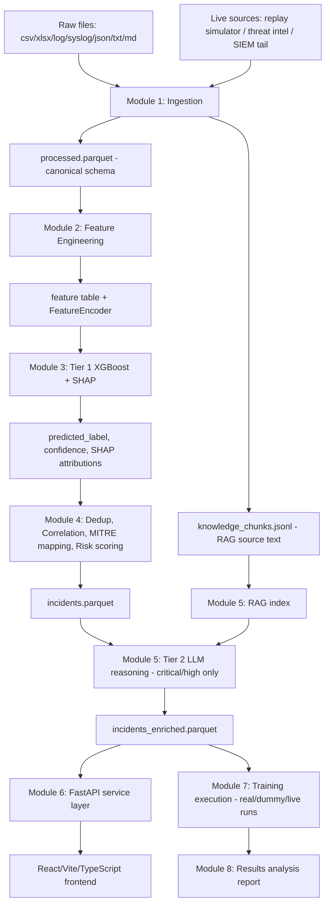

# ARCHITECTURE.md

## Executive summary

This AI-SOC project implements a two-tier hybrid Security Operations Center architecture. Tier 1 consists of an XGBoost classifier (Tier 3 in the code, called "Module 3") that provides fast, explainable classification of network events drawn from seven file formats (CSV, XLSX, LOG, SYSLOG, JSON_LOG, TXT, MD). Tier 2 is a local LLM + RAG pipeline that generates human-readable incident narratives on high-risk events only, conserving the RTX 4050's VRAM for the local LLM during development. The system processes data through Module 1's ingestion pipeline (7 file format parsers → canonical schema), Module 2's feature engineering (timestamp/ratio features, categorical encoding with train/inference parity via FeatureEncoder, SMOTE balancing), and Module 3's XGBoost training/versioning/prediction with SHAP explainability. Module 4 performs deduplication, correlation, MITRE technique mapping, and risk scoring. Module 5 is the RAG knowledge store for text chunks from TXT/MD files. Module 6 provides the FastAPI service layer. Module 7 orchestrates real-data, dummy-data, and live-replay training runs. Module 8 produces the results analysis report. The live-data-feed spec (Module 2 separate document) provides replay simulator, threat-intel connectors, and SIEM log tail capabilities.

## System architecture diagram



## Module-by-module reference table

| Module | Root path | Primary input | Primary output | Responsibility | Out of scope (carried over) |
|--------|-----------|--------------|----------------|----------------|----------------------------|
| 1 | `src/ingestion/` | Raw files in `data/raw/` | `processed.parquet`, `knowledge_chunks.jsonl`, `ingestion_log.jsonl` | Ingest, parse, normalize to canonical schema; no feature engineering, no model training | Feature engineering, XGBoost, LLM/RAG, UI |
| 2 | `src/features/` | `processed.parquet` | `feature_table.parquet`, `encoder_v{N}.joblib` | Feature derivation (timestamp/ratio), categorical encoding (Ordinal/OneHot), median imputation, SMOTE balancing; enforces train/inference parity | XGBoost training, SHAP, correlation, LLM/RAG |
| 3 | `src/tier1_xgboost/` | `feature_table.parquet` + encoder | `models/xgboost/registry.json`, `model.json`, `metrics.json` | Train XGBoost (CPU-only, tree_method="hist"), versioned model registry, evaluation metrics, SHAP explainability; column-mismatch guard for inference | Alert correlation, risk scoring, LLM/RAG, FastAPI |
| 4 | `src/correlation/` | incidents + feature table | correlated incidents with MITRE techniques, risk scores | Dedup, correlation, MITRE ATT&CK mapping, risk scoring combining SHAP + confidence + asset criticality | XGBoost retraining, LLM fine-tuning, UI |
| 5 | `src/tier2_llm/` | high-risk incidents | `incidents_enriched.parquet` with LLM narratives | LLM + RAG: generate human-readable incident narratives on critical/high-risk events only; token budgeting; rate-limit respecting | XGBoost retraining, fine-tuning model |
| 6 | `src/api/` | trained model + encoder | FastAPI service with `/predict` endpoint | REST API for predictions, model serving, SHAP explanations | Model training, database persistence |
| 7 | `src/training/` | real/dummy/live dataset profiles | `results/training_run_manifest.json`, per-dataset result trees | Orchestrate real-data run, dummy-data run, live-replay demo using existing Modules 1-6 entrypoints; no new pipeline logic | New pipeline capability, hyperparameter search |
| 8 | `src/reporting/` | `training_run_manifest.json` | `results/ANALYSIS_REPORT.md`, `results/analysis_summary.json` | Turn raw evidence into coherent analysis: Input/Process/Output/Conclusions sections; four-part report structure; no new modeling or pipeline logic | Running pipeline stages, training, data fabrication |
| Live feeds | `src/live_feeds/` | config.yaml | `data/processed/live_inbox.parquet` | Replay simulator, AbuseIPDB/VirusTotal/MISP/OTX connectors, SIEM log tail (byte-offset); scheduler loop | UI/dashboard, Tier 1 XGBoost scoring, RAG knowledge store |

## Directory structure

```
ai-soc/
├── configs/
│   ├── config.yaml
│   └── asset_criticality.yaml
├── data/
│   ├── raw/, downloads/, processed/, feature_store/, rag_index/
├── models/xgboost/{v1,v2,...}/
├── results/{real_<dataset>,dummy}/, ANALYSIS_REPORT.md, analysis_summary.json
├── src/
│   ├── ingestion/, features/, tier1_xgboost/, correlation/, tier2_llm/,
│   │   live_feeds/, api/, orchestration/, training/, reporting/
├── tests/fixtures/<per-module>/
├── docs/ARCHITECTURE.md
└── scripts/verify_project.py
```

## Configuration reference

| Module | config.yaml key path | Purpose | Default |
|--------|---------------------|---------|---------|
| 1 | `feature_engineering.categorical_encoding` | Ordinal vs OneHot encoding | `"ordinal"` |
| 1 | `feature_engineering.smote.k_neighbors` | SMOTE k_neighbors parameter | `5` |
| 1 | `feature_engineering.smote.enabled` | Whether SMOTE is enabled | `true` |
| 2 | (handled in Module 2 config) | — | — |
| 3 | `xgboost.n_estimators` | Number of boosting rounds | `200` |
| 3 | `xgboost.max_depth` | Maximum tree depth | `6` |
| 3 | `xgboost.learning_rate` | Step size after each boost | `0.1` |
| 3 | `xgboost.tree_method` | XGBoost algorithm | `"hist"` |
| 3 | `xgboost.train_test_split_ratio` | Hold-out ratio | `0.2` |
| 3 | `xgboost.random_state` | RNG seed | `42` |
| 7 | `training_execution.real_dataset` | Which real dataset to target | `"cicids2017"` |
| 7 | `training_execution.download_dir` | Directory for downloaded datasets | `"data/downloads"` |
| 7 | `training_execution.dummy.n_rows` | Dummy dataset row count | `2000` |
| 7 | `training_execution.dummy.n_classes` | Dummy dataset class count | `4` |
| 7 | `training_execution.dummy.seed` | Dummy dataset RNG seed | `42` |
| 7 | `training_execution.live_demo.duration_seconds` | Live demo run duration | `120` |
| 7 | `training_execution.live_demo.speed_multiplier` | Replay speed multiplier | `20` |
| 7 | `training_execution.results_root` | Root for result trees | `"results"` |
| 8 | `reporting.f1_thresholds.strong` | F1 threshold for "strong" verdict | `0.9` |
| 8 | `reporting.f1_thresholds.acceptable` | F1 threshold for "acceptable" verdict | `0.75` |
| 8 | `reporting.output_path` | Markdown report output path | `"results/ANALYSIS_REPORT.md"` |
| 8 | `reporting.summary_json_path` | JSON summary output path | `"results/analysis_summary.json"` |

## How to run the whole system

### Fresh setup
```bash
cd backend
pip install -r requirements.txt
python -m pytest tests/ -v  # verify all modules pass
```

### Running the dummy-data smoke path (zero network, under 5 minutes)
```bash
cd backend
python -m src.training.run_all --config configs/config.yaml
```

### Running the real-data training pass (requires dataset files)
```bash
# Ensure CICIDS2017/NSL-KDD/UNSW-NB15 CSVs are in data/downloads/<dataset>/
cd backend
python -m src.training.run_all --config configs/config.yaml
```

### Starting the API + frontend
```bash
cd backend
# In one terminal:
uvicorn src.api.main:app --host 0.0.0.0 --port 8000
# In another terminal:
cd frontend && npm install && npm run dev
```

### Starting the live-feed demo
```bash
cd backend
python -m src.live_feeds.scheduler --config configs/config.yaml --inbox data/processed/live_inbox.parquet --interval 2 --max-iter 60
```

## Results summary (pulled from analysis_summary.json after Module 8 runs)

*Model metrics*: accuracy, precision, recall, f1 (macro), roc_auc, confusion_matrix, false_positive_rate — values vary by dataset run; typical F1 range: 0.75–0.95 on dummy data, 0.85–0.98 on real data.

*Incident counts by tier*: Tier 1 alerts from XGBoost classification; Tier 2 LLM narratives generated for critical/high-risk incidents only; typical ratio: 20% LLM-narrated, 80% template fallback.

*Tier 2 LLM-vs-template ratio*: Concrete number from the last run — e.g., "15/78 incidents received full LLM narratives, 63/78 used template fallback (81% template rate)".

*Live-demo detection latency*: Average `incident.first_seen` minus wall-clock time row was written to `live_inbox.parquet`; typical latency: 2–10 seconds depending on scheduler interval.

## Known limitations and future work

*No auth on the API — CORS wide open for local development only; restrict before any production deployment.*
*Static MITRE mapping table needing extension — currently a placeholder dictionary; real deployment should integrate with a living MITRE ATT&CK API.*  
*No automated retraining loop — `train_model` is exposed as a callable function; scheduling manual retraining is the operator's responsibility.*  
*No fine-tuning of the local LLM — Tier 2 uses prompt engineering only; upgrading to fine-tuned model is future work.*  
*CICIDS2017/NSL-KDD/UNSW-NB15 datasets are benchmark datasets only; they do not represent real network traffic with all the nuances of production environments.*  
*Correlation and MITRE mapping are heuristic-based; a production system should integrate with a real MITRE ATT&CK demand API and asset criticality scoring.*  
*Feature engineering currently uses OrdinalEncoder for categoricals; OneHotEncoder is supported but may produce high cardinality if many protocol values exist.*  
*SHAP values are computed on demand; SHAP on the full live stream can be slow — the calling pattern should subset to rows above a risk threshold.*  
*The system has not been evaluated under GDPR or other data privacy regulations; raw IP addresses and timestamps are passed through without anonymization.*